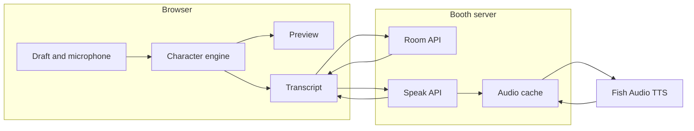

# Booth

Booth is a two-chair conversation for Dunder Mifflin Scranton. A person speaks in their own words. The other chair hears Michael Scott, Dwight Schrute, Jim Halpert, or Pam Beesly: the same meaning, that character's rhythm, and one signature line when the words call for it. Fish Audio speaks the result.

The Office and these characters belong to their owners. This project is a personal prototype. It uses the characters' names and a few of their habits. The audio uses public Fish Audio narrators, not the actors.

## Architecture



| Piece | Responsibility |
| --- | --- |
| Character engine | Runs in the browser and again on the server. Keeps the meaning, adjusts the rhythm, and appends at most one signature. |
| Preview | Shows the rewritten line before a request is made. |
| Room API | Shares the transcript between the two chairs. Polls about once a second. |
| Speak API | Maps a character to a public voice, calls Fish Audio, and returns MP3. The API key never reaches the browser. |
| Audio cache | Stores a performance by model, voice, and text. A second play, including the other chair, does not call Fish again. |

### Data flow

1. The active chair types, or the browser speech recognizer fills the draft. Recognition stays on the device.
2. The character engine rewrites the draft. The preview updates on each keystroke.
3. Send stores the original sentence and the character line, then publishes them to the room.
4. The other chair receives the same line on its next poll.
5. If Speak is on, the browser asks the server to synthesize the original sentence for that character. The server rewrites it again, so the spoken line matches the engine rather than a client-supplied script.
6. Fish Audio Drama 3 returns the audio. The browser plays it. A cache hit returns the stored MP3 and a cost of zero.

## Cast

| Character | Role | Signature | Public voice |
| --- | --- | --- | --- |
| Michael Scott | Regional Manager | "That's what she said." | [Adrian](https://fish.audio/m/bf322df2096a46f18c579d0baa36f41d) |
| Dwight Schrute | Assistant Regional Manager | "False." | [Deep Calm Narrator](https://fish.audio/m/319010b746ea48fe8137531bb52caa49) |
| Jim Halpert | Sales | "Yeah, so that happened." | [Energetic Male](https://fish.audio/m/9a9cf47702da476aa4629e2506d4a857) |
| Pam Beesly | Reception | "Dunder Mifflin, this is Pam." | [Delia](https://fish.audio/m/c70cfb98867a4bfb9ae20d2401257b92) |

"Take the character off" sends the sentence unchanged.

Michael Scott watches ordinary words such as "hard", "long", and "come in". Dwight Schrute answers a wrong fact with "False." and a late report with "That is your emergency, not mine." Jim Halpert marks a meeting. Pam Beesly answers from reception.

A useful first line, as Michael Scott:

```text
This quarterly report is really hard.
```

## Credits

Rewriting a line does not call Fish Audio. Speech uses Drama 3, which takes the same text-to-speech request and follows acting directions in the script. The listed price is $10 per million UTF-8 bytes, so a $20 balance covers about two million characters. Set `FISH_MODEL` in `.env` to `s2.1-pro-free` to spend nothing, or to `s2.1-pro` for the $15 model.

The header shows the spend recorded in this browser. Repeated lines are served from the disk cache. The microphone uses the browser's speech recognizer, so transcription is not billed.

## Hosting

The live booth is [fishaudio-sigma.vercel.app](https://fishaudio-sigma.vercel.app).

The page is a Vite build. On Vercel, the build bundles `/api` into Node functions that use the same handlers as the local Express server. `FISH_API_KEY` and `FISH_MODEL=drama-3` are set in the Vercel project. Do not commit the key.

Rooms and the MP3 cache stay in the function instance. A quiet visit usually keeps both chairs on that instance. A fresh instance starts an empty room and calls Fish again for a line it has not spoken.

## Development

Requirements: Node.js 20 or newer, and a Fish Audio API key if the paid or free Fish voices should speak. Without a key, the rewrite still runs and speech falls back to the browser voice.

```bash
cp .env.example .env
npm install
npm test
npm run dev
```

Open http://127.0.0.1:5173. The composer shows a link for the other chair.

```bash
npm run build
npm start
```

`npm start` serves the production build.

## Repository layout

| Path | Contents |
| --- | --- |
| `src/engine` | Characters, rewrite rules, demo scene, and credit math. Covered by unit tests. Imported by the page and the server. |
| `src/App.tsx` | Two chairs, cast, preview, microphone, and transcript. |
| `server` | Health, rooms, Fish Audio proxy, and the MP3 cache. |
| `api` | Vercel function entry points for the same handlers. |

## API

| Method | Path | Purpose |
| --- | --- | --- |
| `GET` | `/api/health` | Reports whether a key is configured, and which model will be used. |
| `POST` | `/api/rooms` | Opens a room. |
| `GET` | `/api/rooms/:id` | Returns messages after an optional cursor. |
| `POST` | `/api/rooms/:id/messages` | Stores one line after rewriting it. |
| `POST` | `/api/speak` | Returns MP3 for a character and an original sentence. |
